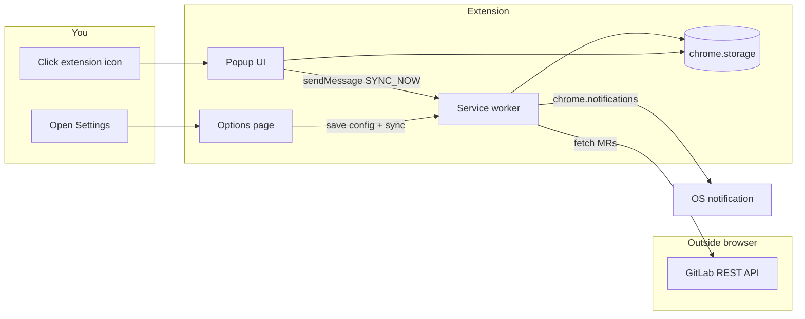
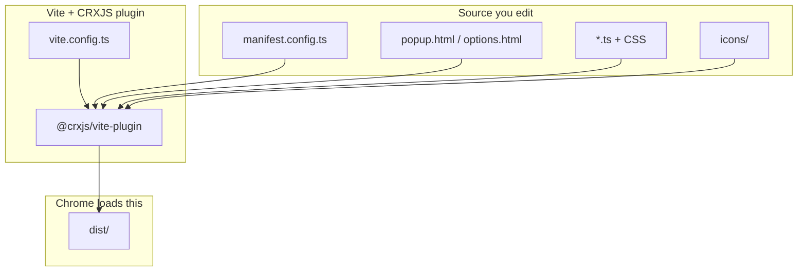

# GitLab MR Tracker — Chrome Extension (learning project)

A minimal **Manifest V3** extension that syncs GitLab merge requests and shows desktop notifications when MR status changes. Source is **TypeScript**, built with **pnpm** and **Vite** (via [@crxjs/vite-plugin](https://crxjs.dev)).

## How a Chrome extension fits together



| Piece | File(s) | When it runs | Job |
|-------|---------|--------------|-----|
| **Manifest** | `manifest.config.ts` | Build + runtime | Declares name, permissions, entry files |
| **Action (popup)** | `src/popup/*` | Only while popup is open | List MRs, manual Sync |
| **Service worker** | `src/background/service-worker.ts` | On events; may sleep when idle | Alarms, API sync, notifications |
| **Options** | `src/options/*` | Full tab when you open Settings | GitLab host, token, filters |
| **Libraries** | `src/lib/*` | Imported by above | GitLab API, storage, diff/notify logic |

Chrome does **not** keep the service worker running forever. It wakes on:

- `chrome.runtime.onInstalled`
- `chrome.alarms` (periodic sync)
- `chrome.runtime.onMessage` (popup/options ask to sync)

That is why sync lives in the background script, not in the popup.

## How the build works (pnpm + Vite)

This is the flow worth learning — it is the same pattern many modern front-end apps use, adapted for extensions:



| Tool | Role |
|------|------|
| **pnpm** | Installs dependencies (fast, strict `node_modules` layout) |
| **Vite** | Dev server + production bundler (Rollup under the hood) |
| **@crxjs/vite-plugin** | Reads the manifest, discovers popup/options/service worker, bundles TS, rewrites paths for `dist/` |
| **TypeScript** | Types only at build time (`tsc -b`); Vite strips types when bundling |

### Entry points Vite knows about

CRXJS starts from `manifest.config.ts` and follows references:

- `action.default_popup` → `src/popup/popup.html` → `<script src="./popup.ts">`
- `options_page` → `src/options/options.html` → `<script src="./options.ts">`
- `background.service_worker` → `src/background/service-worker.ts`
- `icons/*` → copied into `dist/`

You do **not** list every `.ts` file in `vite.config.ts` — the manifest graph is the entry graph.

### Scripts

```bash
pnpm install           # once (requires pnpm: https://pnpm.io/installation)
pnpm run icons         # generate PNG icons if missing
pnpm dev               # watch: rebuild dist/ on save (recommended for UI)
pnpm dev:hmr           # Vite dev server + HMR (may hit CORS; see docs/DEV.md)
pnpm build             # production build → dist/
pnpm run typecheck     # tsc -b (app + vite/manifest configs)
```

| Command | What happens |
|---------|----------------|
| `pnpm dev` | `vite build --watch` — rebuilds `dist/` on save (no localhost/CORS). See [docs/DEV.md](docs/DEV.md). |
| `pnpm dev:hmr` | Vite dev server + hot reload (optional; CORS issues possible) |
| `pnpm build` | Production build in `dist/` |

## Project layout

```
ExtensionProvider/
  manifest.config.ts     ← extension manifest (source of truth)
  vite.config.ts           ← Vite + CRXJS plugin
  package.json             ← scripts + pnpm packageManager field
  icons/
  src/
    types/index.ts
    background/service-worker.ts
    popup/   (html, css, ts)
    options/
    lib/
  dist/                    ← generated; load this in Chrome
  tsconfig.json            ← project references
  tsconfig.app.json        ← types for extension source
  tsconfig.node.json       ← types for vite.config + manifest.config
```

## Load the extension (unpacked)

1. `pnpm install`
2. `pnpm run icons` (if `icons/` is empty)
3. `pnpm dev` **or** `pnpm build`
4. Chrome → `chrome://extensions` → **Developer mode** → **Load unpacked** → select **`dist`**
5. Pin the extension from the puzzle menu

**Dev loop:** run `pnpm dev` (keep it running) → edit CSS/HTML → save → for **options** tab updates live; for **popup** close and reopen. See **[docs/DEV.md](docs/DEV.md)** for side-by-side setup.

## Configure GitLab

1. In GitLab: **Preferences → Access Tokens** (or your self-hosted equivalent)
2. Create a token with **`read_api`** or **`api`** scope
3. Extension → **Settings** (footer link in popup, or right-click extension → Options)
4. Set **Host** (`https://gitlab.com` or your instance URL)
5. Paste token, choose scope/states, Save

On save, the extension reschedules the alarm and runs an immediate sync.

## What sync does

1. Reads config from `chrome.storage.local`
2. Calls `GET /api/v4/merge_requests` per selected state (`opened`, `merged`, `closed`)
3. Compares with the previous snapshot in storage
4. If enabled in settings:
   - **New MR** → notification (skipped on first install to avoid spam)
   - **Status change** (e.g. opened → merged) → notification
5. Saves the new list + `lastSyncAt`

Periodic sync uses `chrome.alarms` (interval from settings, default 5 minutes).

## Permissions (why each one)

| Permission | Why |
|------------|-----|
| `storage` | Save token, config, last MR list |
| `alarms` | Background sync on a timer |
| `notifications` | Desktop alerts |
| `host_permissions` | `fetch()` to your GitLab host |

The token stays in **local** storage on your machine only; it is sent only to your GitLab host as `PRIVATE-TOKEN`.

## Learning path (suggested order)

1. Read `manifest.config.ts` — map keys to files
2. Read `vite.config.ts` — how CRXJS is plugged in
3. Skim `src/types/index.ts` — config, MR, and message shapes
4. Open popup → read `popup.ts` — UI + `sendMessage`
5. Read `service-worker.ts` — alarms and message handler
6. Read `sync.ts` + `gitlab-api.ts` — real GitLab integration
7. Change something small, run `pnpm dev`, reload extension

## Roadmap (good next exercises)

- [ ] Badge on the icon with open MR count (`chrome.action.setBadgeText`)
- [ ] Notify on new comments (needs notes API + more diff logic)
- [ ] Filter by label / project ID in options

## Troubleshooting

| Symptom | Check |
|---------|--------|
| “Access token is not set” | Options → token saved |
| 401 from GitLab | Token expired or wrong scope |
| 404 / network error | Host URL correct (no trailing path like `/group/project`) |
| No notifications | OS notification permissions for Chrome; flags in Settings |
| Empty list | Scope/states — try “All” + “Opened” first |
| Build errors after pull | `pnpm install` then `pnpm build` |
| Wrong folder loaded in Chrome | Must be **`dist`**, not repo root |

## GitLab API reference

- [List merge requests](https://docs.gitlab.com/ee/api/merge_requests.html#list-merge-requests)
- Query params used: `state`, `scope`, `per_page`, `order_by`, `sort`

---

Use **Service worker** → **Inspect** on `chrome://extensions` to debug background logic. For Vite issues, read the terminal where `pnpm dev` is running.
